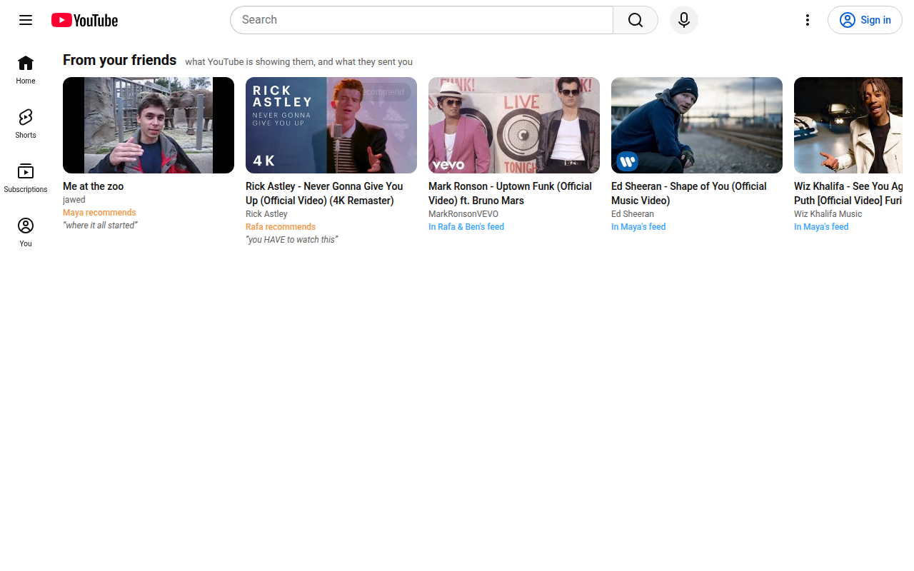

<p align="center"></p>
<h1 align="center">FriendoTube</h1>
<p align="center">See what YouTube is recommending your friends, and send each other videos.</p>
<p align="center">
  <a href="https://chromewebstore.google.com/detail/friendotube/flolldilpofpclolpfojcfebhdeeleem"><b>Get it on the Chrome Web Store</b></a> ·
  <a href="https://friendotube.collinrijock.com/">Website</a> ·
  <a href="https://friendotube.collinrijock.com/privacy">Privacy policy</a>
</p>



YouTube shows every one of your friends a different feed. FriendoTube lets a friend group peek into each other's:

- **From your friends:** a row at the top of your YouTube home with the videos friends sent you, then videos YouTube is recommending them but didn't show you (last 3 days).
- **Recommend:** hover any card, or click **Send to friends** on any video page, and add a note.
- **Groups:** create one in the popup and share its invite code. You can be in several.

Works in Chrome and in [Copper](https://github.com/copper-browser/Copper) (load the `extension/` folder).

## Privacy

The extension uploads only the videos YouTube recommends you on the home page and watch-page sidebar (video id, title, channel) and the videos you choose to send. Only members of your groups see them. No Google account, watch history or searches. Feed data is deleted after 14 days, sharing can be switched off in the popup, and **Delete my account** removes everything at once. Full policy: [friendotube.collinrijock.com/privacy](https://friendotube.collinrijock.com/privacy).

## How it works

| Part | What it is |
|---|---|
| `extension/` | Manifest V3. `content.js` reads YouTube's recommendations and draws the row; `bg.js` makes every API call; `popup.*` handles name, groups and settings. All friend data is rendered with `textContent`. |
| `server/server.mjs` | Node 22, zero dependencies (`node:http` + `node:sqlite`). Parameterized SQL, SHA-256-hashed access keys, per-IP rate limits, CORS only for extension origins, listens on 127.0.0.1 behind a Cloudflare tunnel. |
| `store/` | Chrome Web Store listing text, icon and screenshot generators. |
| `deploy/` | Deploy script and LaunchAgents for the hosted server. |

## Run your own server

```sh
PORT=4330 FRIENDOTUBE_DB=./data/friendotube.db node server/server.mjs
```

Then put its URL in the popup under **Advanced**. The server trusts `CF-Connecting-IP` for rate limiting, so keep it on 127.0.0.1 behind a proxy that sets that header.

## Develop

```sh
node --test server/server.test.mjs                                    # API, security checks
PLAYWRIGHT=<path>/node_modules/playwright-core node test/e2e.mjs      # live youtube.com check
```

YouTube's markup changes often; when the row or the feed upload breaks, the e2e test shows where.

## License

[MIT](LICENSE)
